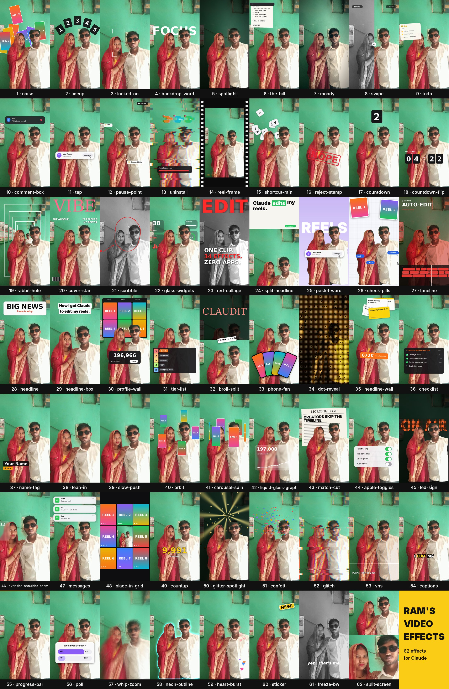
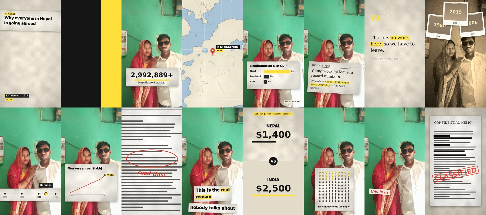

# Ram's Video Effects

**62 video effects for Claude + 22 Vox-style explainer effects + voiced videos from a prompt.** Drop a video (or photo) into Claude, ask for an effect in plain words, and it renders the edit: words behind your head, orbiting reels, spotlights, glass widgets, tier lists, captions, confetti and more. Or type a prompt and get a finished Vox-style video with an AI voice-over (Nepali, English, Hindi), in 9:16 and 16:9.

Made by Ramkesh Gupta ([@ramkesh430](https://github.com/ramkesh430)).



## Example

One photo turned into a 12-second reel: [ram_couple_effects.mp4](ram_couple_effects.mp4)
(RAM word behind us, golden spotlight, pink neon outline, LOVE magazine cover, FOREVER collage). Plan used: [example_plan.json](example_plan.json).


## Vox-style pack (22 more effects)

The [vox/](vox/) folder adds **22 Vox-style explainer effects**: paper cut-out look, newspaper clippings with a yellow
highlighter, maps with pins, paper bar/line charts, big numbers, icon arrays, A-vs-B splits, timelines, quote cards,
document reveals, redactions, hand-drawn arrows, source tags, archive film and block-wipe transitions.



- **In Claude:** "Vox style intro with the headline 'Why rent is so high'", "map-pin on Pokhara at 8 seconds".
- **On GitHub:** use them in your plan like any other effect (start from [vox/example_plan.json](vox/example_plan.json)). The Render effects action picks up `vox/vox.py` automatically.
- **Install:** `bash vox/install.sh` (Windows: `vox\install.ps1`), or upload [vox/ram-vox-effects.zip](vox/ram-vox-effects.zip) in the Claude app.
- All options: [vox/EFFECTS.md](vox/EFFECTS.md) · details: [vox/README.md](vox/README.md)

## Voiced videos from a script or a prompt

`vox/make_video.py` builds a complete video with no footage needed: AI voice-over, a moving paper background,
Vox effects timed to each line, and transitions. Made with it (all in [outputs/](outputs/)):

| video | format | what |
|---|---|---|
| [ram_digital_promo_reel.mp4](outputs/ram_digital_promo_reel.mp4) · [youtube](outputs/ram_digital_promo_youtube.mp4) | 9:16 + 16:9, 68 s | Ram Digital promo: Google Ads, TikTok Ads, UGC AI video, AI automation |
| [nepal_digital_marketing_doc.mp4](outputs/nepal_digital_marketing_doc.mp4) | 16:9, 4.5 min | documentary: digital marketing in Nepal, 1994-2026, with sources |
| [digital_marketing_ne.mp4](outputs/digital_marketing_ne.mp4) | 9:16, 68 s | what is digital marketing (Nepal data, DataReportal) |

- **Prompt → video (fully automatic):** Actions → **Prompt to video** → type what you want, pick 9:16 / 16:9 / both and a voice.
  Claude writes the script, then the video is rendered. One-time setup: repository secret `ANTHROPIC_API_KEY`.
- **Script → video:** copy a script from [vox/scripts/](vox/scripts/), change the `say` lines and effects,
  then Actions → **Make Vox video** (format: as in the script, 9:16, 16:9 or both).
- **In Claude:** "make a 60 sec Nepali reel about X with Vox effects" - Claude writes the script and runs it.

Details: [vox/README.md](vox/README.md).

## Ways to use it

| option | needs | best for |
|---|---|---|
| **1. Claude skill** (below) | Claude Code or the Claude app | asking in plain words: "orbit from 3 to 6 seconds" |
| **2. Right here on GitHub** | only a GitHub account | no install at all — upload, wait, download |
| **3. Google Colab** [](https://colab.research.google.com/github/ramkesh430/ram-video-effects/blob/main/ram_video_effects.ipynb) | a Google account | phone or any computer, free |
| **4. With the original skill too** | Claude Code | having both this pack and [Vibha's claude-video-effects](https://github.com/Vibha-Ramprakash/claude-video-effects) |
| **5. Prompt to video** (GitHub Action) | a GitHub account + Anthropic API key | type a prompt, get a voiced Vox-style video |
| **6. Make Vox video** (GitHub Action) | only a GitHub account | turn a script in `vox/scripts/` into a voiced video |

### Option 2 — render on GitHub (no install)

1. Fork this repo (or use your own copy).
2. Open the **inputs/** folder → **Add file → Upload files** → add your video or photo.
   Optional: add `NAME.json` (same name as the video) or `plan.json` with your effects. Without one, [example_plan.json](example_plan.json) is used.
3. Commit. The **Render effects** action starts by itself (Actions tab, ~3–6 min).
4. Your video appears in **outputs/NAME_effects.mp4** (and as a download on the run page).

Or: **Actions → Render effects → Run workflow**, type a file path (e.g. `original_photo.jpg`) and a plan.

### Option 3 — Google Colab

Click the badge above, press ▶ on each cell: setup → upload → edit the effects list → preview → render & download.

### Option 4 — also install the original skill

```bash
bash ram-video-effects/install.sh --with-original                                   # Mac / Linux
powershell -ExecutionPolicy Bypass -File ram-video-effects\install.ps1 -WithOriginal   # Windows
```

This adds Vibha Ramprakash's original skill at `~/.claude/skills/effects` next to this one. Say `/effects …` for the original, or "use ram-video-effects …" for this pack.

## Install (one line)

**Mac / Linux** — open Terminal:

```bash
git clone https://github.com/ramkesh430/ram-video-effects && bash ram-video-effects/install.sh
```

**Windows** — open PowerShell:

```powershell
git clone https://github.com/ramkesh430/ram-video-effects; powershell -ExecutionPolicy Bypass -File ram-video-effects\install.ps1
```

The installer sets up Python packages, ffmpeg, the two AI models (person cut-out + face finder), optional fonts, and copies the skill to `~/.claude/skills/ram-video-effects`. Then restart Claude Code.

**Claude app (web / desktop):** download [ram-video-effects.zip](ram-video-effects.zip) and upload it in **Settings → Capabilities → Skills**.

## Use it

Drag your video into Claude and type what you want:

- `/effects orbit from 3 to 6 seconds`
- `/effects spotlight when I say "lights off", with the word FOCUS behind me`
- `/effects backdrop-word RAM for the first 2 seconds, then confetti`
- `/effects red-collage at the end with "ONE CLIP. 62 EFFECTS. ZERO APPS."`

Claude checks a few frames first, fixes anything that covers your face, then renders `yourvideo_effects.mp4` next to the original. Your audio is kept.

Tips:

- Vertical phone videos with you in frame work best. Photos work too (Claude turns them into a slow-zoom clip).
- Say timings in plain words ("when I say 'watch'"); Claude finds the exact second.
- For your own reels in orbit, noise, phone-fan, profile-wall, place-in-grid: give Claude a folder of screenshots.
- Use your real numbers for counters and graphs.

## Run it without Claude

```bash
python fx.py --list                                           # every effect + options
python fx.py in.mp4 check.png --plan plan.json --preview 1.5,4 --debug   # check frames first
python fx.py in.mp4 out.mp4 --plan plan.json                  # render (add --max-short 2160 for 4K)
```

`plan.json`:

```json
[{"fx": "backdrop-word", "start": 0, "end": 3, "text": "RAM"},
 {"fx": "glitter-spotlight", "start": 3, "end": 5.5},
 {"fx": "red-collage", "start": 10, "end": 12, "word": "FOREVER"}]
```

All 62 effects and their options: **[EFFECTS.md](EFFECTS.md)**.

## Effects

noise · lineup · locked-on · orbit · lean-in · backdrop-word · spotlight · the-bill · moody · swipe · todo · comment-box · tap · pause-point · uninstall · reel-frame · shortcut-rain · reject-stamp · countdown · countdown-flip · rabbit-hole · cover-star · scribble · glass-widgets · red-collage · split-headline · pastel-word · check-pills · timeline · headline · headline-box · profile-wall · tier-list · broll-split · phone-fan · dot-reveal · headline-wall · checklist · name-tag · slow-push · carousel-spin · liquid-glass-graph · match-cut · apple-toggles · led-sign · over-the-shoulder-zoom · messages · place-in-grid · countup · glitter-spotlight · confetti · glitch · vhs · captions · progress-bar · poll · whip-zoom · neon-outline · heart-burst · sticker · freeze-bw · split-screen

## Files

| file | what |
|---|---|
| `fx.py` | the effects engine (single file) |
| `SKILL.md` | Claude skill instructions |
| `install.sh` / `install.ps1` | installers |
| `requirements.txt` | Python packages |
| `EFFECTS.md` | every effect and its options |
| `example_plan.json` | the plan behind the example video |
| `ram-video-effects.zip` | skill for upload in the Claude app |
| `render_inputs.py` | renders everything in `inputs/` (used by the GitHub Action) |
| `.github/workflows/render.yml` | the "Render effects" GitHub Action |
| `vox/vox.py` | 22 Vox-style effects (loads `fx.py`, so all 84 effects work) |
| `vox/make_video.py` | script → voice-over + background + effects → finished video (9:16 or 16:9) |
| `vox/prompt_to_script.py` | prompt → script, written by Claude (needs `ANTHROPIC_API_KEY`) |
| `vox/scripts/` | example scripts (promo, explainer, documentary) |
| `vox/ram-vox-effects.zip` | the Vox skill for upload in the Claude app |
| `.github/workflows/vox-video.yml` · `prompt-video.yml` | the "Make Vox video" and "Prompt to video" GitHub Actions |
| `ram_video_effects.ipynb` | Google Colab notebook |
| `inputs/` · `outputs/` | drop videos here · rendered results appear here |

## Honest notes

- These are draft edits. Watch the result before you post.
- No music, sound effects or subtitles are added unless you ask for the `captions` effect. Voiced videos use an AI voice (edge-tts); listen before posting.
- Charts and numbers only show what you give them: use real data and name the source.
- If something looks off, tell Claude ("the word covers my face", "too fast") and it re-renders.

## Credits

Person cut-out and face detection: Google MediaPipe (Apache 2.0). AI voices: Microsoft Edge neural voices via edge-tts. Fonts: Google Fonts (SIL OFL / Apache 2.0), downloaded by the installer. Effect ideas inspired by [claude-video-effects](https://github.com/Vibha-Ramprakash/claude-video-effects); this code is written from scratch. Code licence: MIT (see [LICENSE](LICENSE)). The example photo and video are personal and not covered by the licence.
