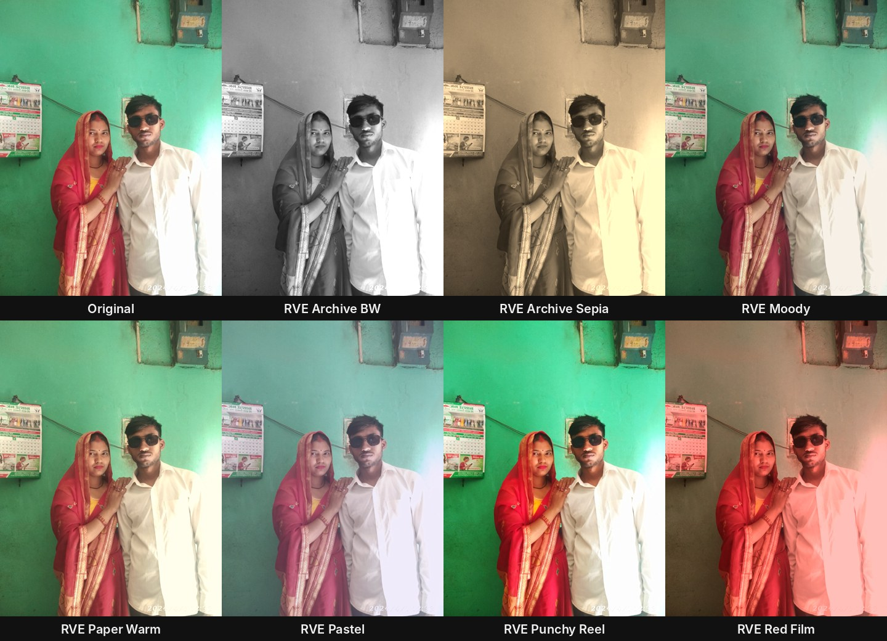

# DaVinci Resolve presets - Ram's Video Effects

Works in **DaVinci Resolve 18, 19, 20 (free and Studio)**.

## 1. Fusion templates (titles, effect, transition, generator)

**Install:** double-click `RamVideoEffects.drfx` (or drag it onto the Resolve window), then restart Resolve.
**Nepali:** `RamVideoEffects.drfx` ma double-click garnus, Resolve restart garnus. Edit page → Effects → "Ram Video Effects" ma aauchha.

| where in Effects | preset | what it does | change in Inspector |
|---|---|---|---|
| Titles | RVE Torn Headline | paper strip + yellow kicker + bold headline, slides in | Kicker, Headline, font, size |
| Titles | RVE Marker Text | key line on a white strip, yellow highlighter wipes behind it | Text, highlight width |
| Titles | RVE Context Label | typewriter place/date lower-third with yellow bar | Label |
| Titles | RVE Source Tag | small "Source: ..." chip | Source, position |
| Titles | RVE Big Number | big number on a paper card, pops in, yellow underline | Number, Label |
| Titles | RVE Sticker | tilted yellow badge that pops ("NEW!", "DM US") | Text, position, angle |
| Titles | RVE Name Tag | lower-third: name + role | Name, Title |
| Titles | RVE Progress Bar | yellow bar fills along the bottom for the clip length | colour, thickness |
| Effects | RVE Glass Card | frosted glass card on your video (blur behind) with a title + value | Title, Value, card position/size, frost |
| Transitions | RVE Block Wipe | yellow + black blocks sweep across, cut in the middle | block colour |
| Generators | RVE Paper Background | warm paper texture with vignette (for explainers) | paper colour, grain |

Use: drag a **Title** onto a track above your clip; drag **RVE Glass Card** onto the clip itself;
drop **RVE Block Wipe** between two clips (about 15-20 frames); put **RVE Paper Background** on V1 for text-only scenes.
Animations start at the beginning of the title/effect - trim the start to time them.

## 2. LUTs (colour looks)

`luts/`: RVE Paper Warm, RVE Archive Sepia, RVE Archive BW, RVE Moody, RVE Red Film, RVE Pastel, RVE Punchy Reel.

**Install:** Resolve → Project Settings → Color Management → **Open LUT Folder**, copy the `.cube` files there,
then **Update Lists**. Use: Color page → LUTs panel, or right-click a node → LUT. Lower the node's Key Output Gain to soften.

## Notes
- Fonts: Arial Black, Arial, Courier New (on almost every computer). Pick any font in the Inspector.
- Built for 16:9 and 9:16 timelines (they follow the timeline size); move things with the Center controls.
- These were generated by `make_presets.py` and checked for structure, but not tested inside Resolve by the author of this pack. If a preset shows an error, open an issue with a screenshot.
